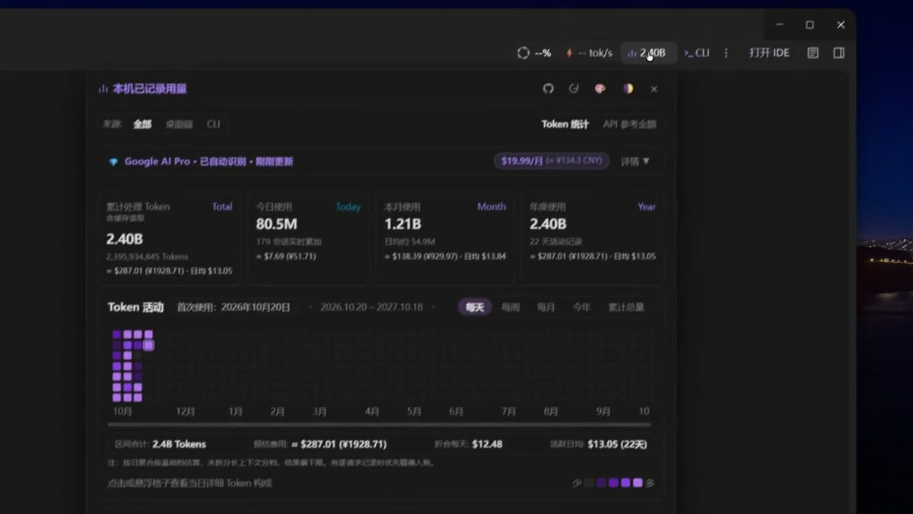

# Visor de contexto y tokens para Antigravity

[简体中文](README.md) · [English](README.en.md) · [日本語](README.ja.md) · [한국어](README.ko.md) · **Español**

Consulta cuánto contexto usa tu conversación, a qué velocidad responde el modelo y cuántos tokens has usado en la aplicación de escritorio y la CLI desde la barra de Google Antigravity 2.x.

## Demostración

[](https://raw.githubusercontent.com/elviscjn-cjn/antigravity-context-viewer/main/assets/demo.mp4)

[Ver la demostración completa (unos 2 minutos)](https://raw.githubusercontent.com/elviscjn-cjn/antigravity-context-viewer/main/assets/demo.mp4)

## Funciones

- **Contexto y velocidad**. Consulta el contexto usado, el límite del modelo, el tiempo hasta el primer token (TTFT), la velocidad de salida y el tiempo total. El uso informado por el servidor se muestra por separado de las estimaciones locales.
- **Detalles de la conversación**. Desglosa las solicitudes, respuestas, razonamiento, herramientas y adjuntos. Consulta las estimaciones de adjuntos, su cobertura y las dimensiones de imágenes cuando estén disponibles. El panel distingue desbordamientos de contexto, límites de frecuencia y errores de red.
- **Historial de tokens**. Combina los datos locales legibles de escritorio y CLI, o filtra por origen. Explora vistas diarias, semanales, mensuales, anuales y acumuladas.
- **Estimaciones de API y suscripción**. Estima el coste de entrada, caché y salida con las tarifas compatibles e identifica el uso sin precio. Compara el coste equivalente de API con precios regionales de referencia o con tu pago real, con selección de moneda y conversión a CNY. Las estimaciones sirven para comparar. Consulta al proveedor para conocer los cargos reales.
- **Apariencia**. La barra se adapta al espacio disponible y los paneles se abren por separado. Puedes cambiar de tema y elegir los colores del mapa de calor.
- **CLI y actualizaciones**. Abre la CLI instalada desde la barra usando el espacio de trabajo y el proxy cuando estén disponibles. Busca actualizaciones en el panel. El instalador admite copias de seguridad, comprobaciones de integridad y restauración.

## Idioma de la interfaz

Las cinco versiones del README son traducciones de la documentación. La interfaz se muestra en chino simplificado y no incluye un selector de idioma. Para usar otro idioma, sigue [AGENTS.md](AGENTS.md), traduce los textos de `src/renderer/`, vuelve a compilar e instala el resultado.

---

## 🤖 Instrucciones para Agentes de IA

```bash
node cli.js install
node cli.js status
```

---

## 🚀 Inicio Rápido

- **Windows**: [`install.bat`](install.bat) / [`uninstall.bat`](uninstall.bat)
- **macOS / Linux**: `./install.sh` / `./uninstall.sh`
- **CLI**: `node cli.js check` / `install` / `status` / `restore`

---

## 🧪 Pruebas Automatizadas

```bash
npm test
```
Las pruebas cubren el contexto, el almacenamiento, el proxy, el estado de la interfaz y la suscripción.

---

## 🤝 Comunidad

- **[LINUX DO](https://linux.do/)**: Apoyamos activamente a la comunidad LINUX DO.
