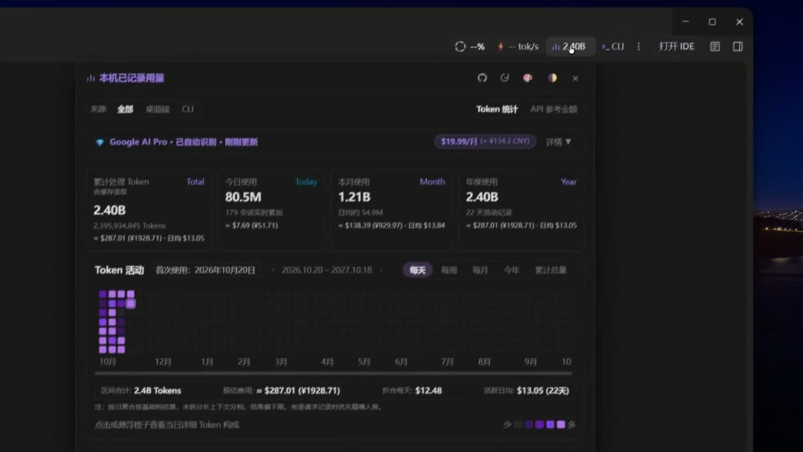

# Antigravity 컨텍스트 및 토큰 뷰어

[简体中文](README.md) · [English](README.en.md) · [日本語](README.ja.md) · **한국어** · [Español](README.es.md)

Google Antigravity 2.x 도구 모음에서 대화의 컨텍스트 사용량, 모델 응답 속도, 데스크톱과 CLI의 토큰 사용량을 확인할 수 있습니다.

## 데모

[](https://raw.githubusercontent.com/elviscjn-cjn/antigravity-context-viewer/main/assets/demo.mp4)

[전체 데모 보기 (약 2분)](https://raw.githubusercontent.com/elviscjn-cjn/antigravity-context-viewer/main/assets/demo.mp4)

## 기능

- **컨텍스트와 속도**. 컨텍스트 사용량, 모델 한도, 첫 토큰까지 걸린 시간(TTFT), 출력 속도와 전체 생성 시간을 표시합니다. 서버 사용량과 로컬 추정치를 구분합니다.
- **대화 상세**. 프롬프트, 응답, 사고, 도구 호출 및 첨부 파일을 확인합니다. 첨부 파일 추정치와 읽기 범위, 확인 가능한 이미지 크기를 표시합니다. 컨텍스트 초과, 호출 제한, 네트워크 오류 등을 구분합니다.
- **토큰 기록**. 읽을 수 있는 데스크톱과 CLI의 로컬 사용량을 합산하고 출처별로 필터링합니다. 일간, 주간, 월간, 연간 및 누적 보기를 제공합니다.
- **API 비용 추정과 구독**. 지원되는 요금으로 입력, 캐시, 출력 비용을 추정하고 산정할 수 없는 사용량을 표시합니다. 지역별 기준가나 실제 결제액을 API 환산액과 비교할 수 있으며 통화 선택과 위안화 환산을 지원합니다. 추정치는 비교용이며 실제 청구 금액은 서비스 제공업체에서 확인하세요.
- **외관**. 도구 모음은 공간에 맞춰 줄어들며 두 패널을 따로 열 수 있습니다. 밝은 테마와 어두운 테마, 히트맵 프리셋과 단계별 색상을 지원합니다.
- **CLI 및 업데이트**. 도구 모음에서 설치된 CLI를 실행하고 가능한 경우 현재 작업 공간과 프록시를 사용합니다. 패널에서 업데이트를 확인할 수 있습니다. 설치 프로그램은 백업, 무결성 검사 및 복원을 지원합니다.

## 인터페이스 언어

다섯 언어는 README 번역입니다. 인터페이스 기본 언어는 중국어 간체이며 앱 내 언어 선택 메뉴는 없습니다. 다른 언어가 필요하면 [AGENTS.md](AGENTS.md)에 따라 `src/renderer/`의 UI 문구를 번역한 뒤 다시 빌드하고 설치하세요.

---

## 🤖 AI 에이전트 설치 명령어

```bash
node cli.js install
node cli.js status
```

---

## 🚀 빠른 시작

- **Windows**: [`install.bat`](install.bat) / [`uninstall.bat`](uninstall.bat)
- **macOS / Linux**: `./install.sh` / `./uninstall.sh`
- **CLI**: `node cli.js check` / `install` / `status` / `restore`

---

## 🧪 테스트 실행

```bash
npm test
```
컨텍스트 집계, 저장소, 프록시 설정, UI 상태와 구독 설정을 테스트합니다.

---

## 🤝 커뮤니티

- **[LINUX DO](https://linux.do/)**: LINUX DO 커뮤니티를 지지하고 응원합니다.
