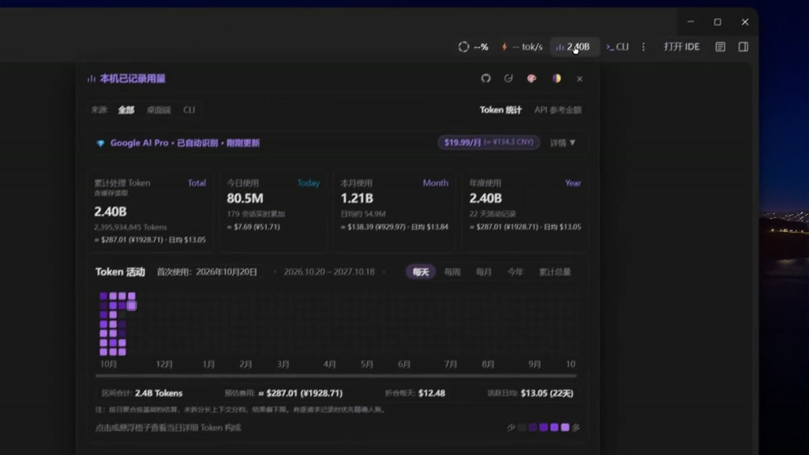

# Antigravity 对话上下文查看器与 Token 用量看板

**简体中文** · [English](README.en.md) · [日本語](README.ja.md) · [한국어](README.ko.md) · [Español](README.es.md)

在 Google Antigravity 2.x 顶栏查看当前对话用了多少上下文、模型生成有多快，以及桌面端和 CLI 一共用了多少 Token.

## 演示

[](https://raw.githubusercontent.com/elviscjn-cjn/antigravity-context-viewer/main/assets/demo.mp4)

[观看完整演示（约 2 分钟）](https://raw.githubusercontent.com/elviscjn-cjn/antigravity-context-viewer/main/assets/demo.mp4)

## 功能

- **上下文和速度**. 查看本轮上下文占用、模型预算、首字延迟（TTFT）、输出速度和总耗时。服务端用量与本地估算分别显示。
- **会话明细**. 展开提示词、回复、思考、工具调用和附件统计。可读取的附件会列出估算和覆盖情况，图片可显示像素尺寸。面板区分上下文溢出、限流和网络等常见问题。
- **Token 历史**. 汇总本地可读取的桌面端和 CLI 用量，可按来源筛选。查看日历热力图、周柱状图、月日历、年度气泡和累计曲线。
- **API 参考金额和订阅**. 按支持的模型费率估算输入、缓存和输出金额，并列出未计价的用量。可比较地区参考价、自定义实付和 API 等值金额，支持币种选择及人民币折算。API 等值金额仅供比较，实际账单以服务商为准。
- **外观**. 顶栏随可用空间收起，两个面板独立展开。支持深浅主题、热力图预设和逐档配色。
- **CLI 和更新**. 从顶栏启动已安装的 Antigravity CLI，尽量沿用当前工作区和代理。可在面板内检查更新。安装器提供备份、完整性校验和还原。

## 界面语言

这五份 README 是文档翻译。插件界面默认为简体中文，目前没有语言切换菜单。需要其他语言时，按 [AGENTS.md](AGENTS.md) 翻译 `src/renderer/` 中的界面文案，重新构建并安装。

---

## 🤖 给 AI 智能体的一键安装指令 (For AI Agents)

如果你将本仓库交给 AI 助手安装，只需对 AI 说：**“读取仓库里的 `AGENTS.md` 或 `README.md`，帮我安装这个上下文查看器与 Token 看板”**。

AI 智能体只需在仓库根目录执行以下单条命令即可完成**持久化安装 + 当前运行窗口免重启热生效**：

```bash
# 1. 一键持久化安装并热注入当前运行中的 Antigravity 窗口（无需强杀进程、无需 npm install）
node cli.js install

# 2. 验证安装与运行状态
node cli.js status
```

> [!IMPORTANT] **AI 智能体执行规范（见 [`AGENTS.md`](AGENTS.md)）**：
> - **零外部依赖**：内置原生 Node.js ASAR 解包/封包引擎（[`asar-engine.js`](asar-engine.js)），无需执行 `npm install`。
> - **汉化补丁**：安装器检查未修改文件的 SHA-256，以检测对其他补丁内容的意外修改. 兼容性仍需按客户端与补丁版本验证.
> - **严禁强杀宿主进程**：在 Antigravity 会话内执行时，切勿关闭或杀死 `Antigravity.exe`；`node cli.js install` 会自动通过 `DevToolsActivePort` 将最新 UI 热挂载到当前窗口，尝试让当前窗口加载新界面，结果以安装输出和 `status` 为准.

---

## 🚀 快速开始 (Quick Start)

### 方式一：一键脚本（适合日常手动安装）

- **Windows**：
  - 安装 / 更新：双击运行 [`install.bat`](install.bat)
  - 卸载 / 还原：双击运行 [`uninstall.bat`](uninstall.bat)
- **macOS / Linux**：
  - 安装 / 更新：`./install.sh`
  - 卸载 / 还原：`./uninstall.sh`

### 方式二：CLI 命令行管理器

```bash
# 1. 环境健康预检（自动探测 Node、Antigravity 安装路径、CDP 端口与 Python）
node cli.js check

# 2. 一键安装（ASAR 持久化注入 + 当前运行窗口 CDP 即时热生效）
node cli.js install

# 3. 仅对当前运行窗口进行 CDP 免改盘热挂载
node cli.js live

# 4. 查看当前安装状态与实时会话上下文用量
node cli.js status

# 5. 一键无损还原安装前的原始 app.asar
node cli.js restore

# 6. 指定自定义客户端路径安装
node cli.js install --path "<path-to-app.asar>"
```

---

## 🧪 自动化测试 (Testing)

```bash
npm test
```

测试覆盖 Token 去重、服务端超限、会话切换、存储失败、代理配置、订阅设置与渲染层状态. 附件扫描测试可单独运行 `python -m unittest attachment_scan_test.py`. 单测不替代宿主客户端中的安装与界面验证.

---

## 📁 仓库结构 (Repository Structure)

```text
antigravity-context-viewer/
├── assets/                                 # 演示动图、高清录屏与实拍截图
│   ├── demo-01-context-audit.gif / .mp4    # 演示 1：会话上下文监控与底层技术参数附件审计
│   ├── demo-02-token-heatmap.gif / .mp4    # 演示 2：Token 历史用量统计与 52 周活跃热力图交互
│   ├── demo-03-panel-switching.gif / .mp4  # 演示 3：独立双面板平滑切换与侧边栏防遮挡自适应
│   ├── demo-04-responsive-collapse.gif/.mp4# 演示 4：顶栏胶囊多级响应式折叠与窄屏自适应
│   ├── panel-context-main.png              # 实拍 1：会话上下文与生成监控主视图
│   ├── panel-context-audit-expanded.png    # 实拍 2：会话上下文全展开：外观调色与底层审计
│   ├── capsule-speed-and-tooltip.png       # 实拍 3：顶栏环形胶囊、实时速度与原生气泡提示
│   └── panel-token-heatmap-customizer.png  # 实拍 4：Token 用量总览与 5 档热力图逐格独立自定义
├── asar-engine.js                          # 零外部依赖的纯原生 Node.js ASAR 打包/解包引擎
├── cli.js                                  # 统一命令行接口 (install / live / status / check / restore)
├── install.js                              # ASAR 注入与运行时热挂载调度器
├── restore.js                              # 原始备份校验与无损还原调度器
├── meter-main.js                           # Electron 主进程窗口钩子与只读 IPC 通道
├── meter-core.js                           # 上下文估算、Token 统计与分词引擎
├── meter-renderer.js                       # 渲染层构建产物
├── src/renderer/                           # 渲染层源码
├── scripts/                                # 构建、发布打包与基准测试
├── meter-collector.js                      # 本地会话归档读取与附件提取收集器
├── attachment_scan.py                      # 全格式附件只读分析核心脚本 (Office / PDF / Code)
├── AGENTS.md                               # AI 智能体专用一键安装与校验指南
├── install.bat / install.sh                # 一键安装入口脚本
└── uninstall.bat / .sh                     # 一键卸载与还原入口脚本
```

---

## 🤝 社区与支持 (Community & Acknowledgements)

- **[LINUX DO](https://linux.do/)**：本项目支持并认可 LINUX DO 社区，欢迎各位社区佬友交流探讨。
