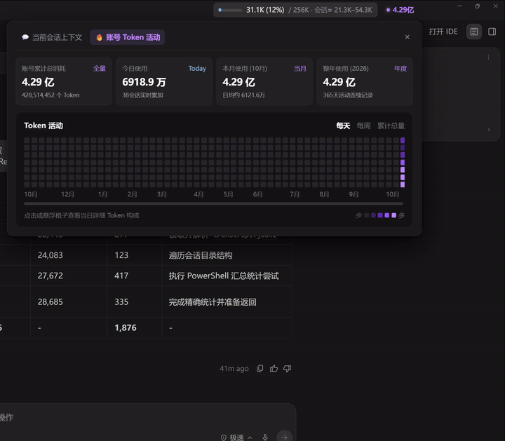
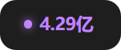
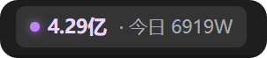
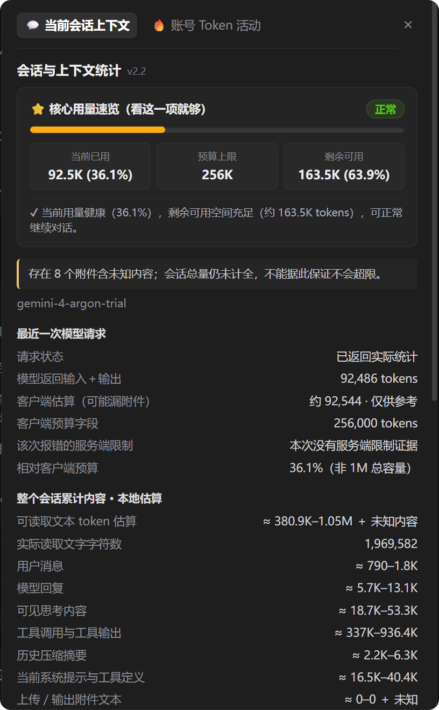
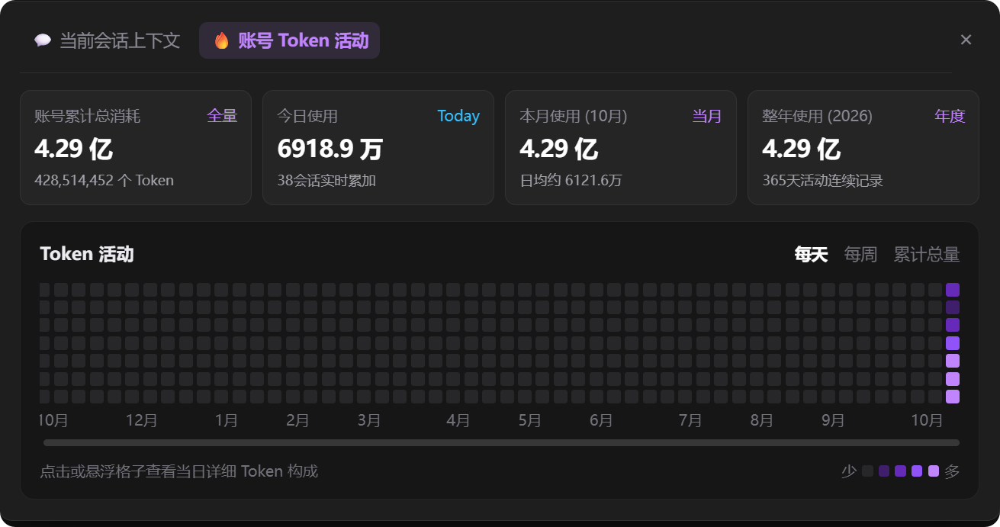

# Antigravity 对话上下文查看器 & Token 用量看板 (Antigravity Context & Token Viewer)

<p align="center">
  
  
  
  
  
  <a href="https://linux.do/"></a>
</p>

<p align="center">
  <b>简体中文</b> | <a href="README.en.md">English</a> | <a href="README.ja.md">日本語</a> | <a href="README.ko.md">한국어</a> | <a href="README.es.md">Español</a>
</p>

专为 **Google Antigravity 桌面客户端 (2.x)** 打造的原厂级 **「单次对话上下文进度条 + 账号全局 Token 计数与活动热力图」** 双合一可视化套件。采用与 `antigravity-chinese` 相同的 **ASAR 持久化注入 + CDP 免重启热挂载** 架构，**零第三方 npm 依赖**，既支持双击脚本一键安装，也支持直接丢给任何 AI 智能体（Antigravity / Codex / Claude Code / Cursor）一句话自动部署。

---

## 🎬 界面与交互预览 (Preview)

### 1. 双模块合并完整演示 (Combined Full Demo)

<p align="center">
  <a href="assets/demo.mp4">
    
  </a>
  <br>
  <sub>🎬 演示动画：上下文查看器 + Token 热力图多视图切换 (<a href="assets/demo.mp4">Full Demo Animation</a>)</sub>
</p>

### 2. 顶栏双胶囊独立动效与状态拆解 (Topbar Capsules)

顶栏右上角常驻两枚无边框原生胶囊，未交互时采用 `#1e1e1e` 隐形融于顶栏，指针移入时以 `cubic-bezier(0.16, 1, 0.3, 1)` 阻尼曲线丝滑过渡至 `#343434` 并平滑展开详情：

| 功能模块 | 独立演示动画 (Demo Animation) | 常驻默认态 (`#1e1e1e`) | 悬停展开态 (`#343434`) |
| :--- | :---: | :---: | :---: |
| **💬 当前对话上下文**<br>*(Session Context)* | <a href="assets/demo-context.mp4"></a><br><sub><a href="assets/demo-context.mp4">🎬 演示动画 (Context Demo)</a></sub> | <br><sub>仅展示进度条 + 已用百分比</sub> | <br><sub>平滑展开预算上限与会话估算</sub> |
| **🔥 账号 Token 计数**<br>*(Account Token Tracker)* | <a href="assets/demo-token.mp4"></a><br><sub><a href="assets/demo-token.mp4">🎬 演示动画 (Token Demo)</a></sub> | <br><sub>仅展示呼吸指示点 + 累计总消耗</sub> | <br><sub>平滑展开今日实时消耗量</sub> |

### 3. 双标签详情面板实拍对比 (Dual-Tab Detail Panels)

点击顶栏任意胶囊即可弹出 `#1e1e1e` 原生暗色面板，支持在 **「💬 当前会话上下文」** 与 **「🔥 账号 Token 活动」** 两个标签页之间无缝切换：

| 💬 标签页一：当前会话上下文查看器 | 🔥 标签页二：账号 Token 计数与活动热力图 |
| :---: | :---: |
|  |  |
| 置顶 **「⭐ 核心用量速览（看这一项就够）」**，一眼看清**当前已用 / 预算上限 / 剩余可用**与一句话健康度结论；下方完整保留模型实际返回 Token、服务端 1M 超限预警与本地全格式附件占用拆解。 | 顶部四栏卡片展示 **账号累计总消耗、今日使用、本月使用、整年使用**；下方提供 **7×52 周活动热力图网格**，支持 **「每天 / 每周 / 累计总量」** 三视图切换、面积折线走势图与每日输入/输出/缓存悬浮气泡。 |

---

## ✨ 两大核心功能模块详解 (Features)

### 模块一：💬 当前对话上下文查看器 (Session Context Viewer)
1. **原生无边框融合进度条**：
   - 未悬停时底色为 `#1e1e1e`，仅显示**可视化彩色进度条 + 已用上下文数值与百分比**（如 `92.5K (36%)`），不遮挡视线。
   - 进度条支持三级动态色彩预警：健康（`<75%` 靛蓝 `#69c0ff`）、偏高预警（`75%–90%` 琥珀黄 `#faad14`）、临界或服务端超限（`≥90%` 警示红 `#ff4d4f`）。
2. **「⭐ 核心用量速览（看这一项就够）」首屏卡片**：
   - 点开面板最上方直接汇总**当前已用 / 预算上限 / 剩余可用**三栏核心数字与状态胶囊（正常 / 偏高 / 紧张 / 已超限），无需在复杂字段中翻找。
3. **真实服务端口径校准 + 全格式本地附件扫描**：
   - 严格区分**模型返回的真实输入+输出 Token**、**客户端预算上限**与**本地全会话估算**。一旦触发服务端 `1,048,576` (1M) 超限报错（HTTP 400）立即强制标红预警，拒绝虚假安全百分比。
   - 内置只读附件扫描器，自动解析当前会话挂载的 `.xlsx`、`.xlsm`、`.xls`、`.xlsb`、`.csv`、`.pdf`、`.docx`、`.pptx` 及代码/文本附件的字符与 Token 占用。

### 模块二：🔥 账号全局 Token 计数与活动看板 (Account Token Tracker)
1. **四大维度 Token 消耗看板**：
   - 实时汇总展示当前账号的 **累计总消耗（全量）**、**今日使用（Today）**、**本月使用（当月）** 与 **整年使用（年度）**，支持万/亿单位自适应缩写与精确数值对照。
2. **ChatGPT / GitHub 风格 7×52 周活跃热力图**：
   - 采用 5 阶暗黑至亮紫梯度色阶呈现全年 365 天 Token 消耗分布。
   - 鼠标悬浮或点击任意日期格子，即时弹出 Tooltip 气泡展示**当日总消耗**及**输入 (Prompt) / 输出 (Output) / 缓存命中 (Cache)** 三项明细拆解。
3. **「每天 / 每周 / 累计总量」三视图无缝切换**：
   - 点击面板右上角切换按钮，可在 **7×52 日历热力图（每天）**、**周度消耗趋势图（每周）** 与 **历史累计增长面积折线图（累计总量）** 之间自由切换。

---

## 🌐 界面语种与多语言翻译说明 (UI Localization & Multi-Language)

本项目默认界面文案为 **简体中文**。如果你需要插件界面（顶栏胶囊文案、详情面板与热力图提示）显示为你自己的母语（例如 **English / 日本語 / 한국어 / Español** 或任意其他语言）：

> [!TIP]
> **无需安装额外多语言包，也无需手动修改配置文件！**  
> 只需要把本仓库交给你的 AI 智能体（Antigravity / Claude Code / Codex / Cursor）安装时，对它说一句：  
> **“读取 AGENTS.md 帮我安装，并把界面文案翻译成 [你的目标语言，如 English / 日本語 / 한국어 / Español]”**  
> 
> AI 就会自动解析 `meter-renderer.js` 中的 UI 文本，将其无损替换为对应语言并执行安装热注入，免重启即刻呈现本地化界面。

---

## 🤖 给 AI 智能体的一键安装指令 (For AI Agents)

如果你将本仓库交给 AI 助手安装，只需对 AI 说：**“读取仓库里的 `AGENTS.md` 或 `README.md`，帮我安装这个上下文查看器与 Token 看板”**。

AI 智能体只需在仓库根目录执行以下单条命令即可完成**持久化安装 + 当前运行窗口免重启热生效**：

```bash
# 1. 一键持久化安装并热注入当前运行中的 Antigravity 窗口（无需强杀进程、无需 npm install）
node cli.js install

# 2. 验证安装与运行状态
node cli.js status
```

> [!IMPORTANT] **AI 智能体执行规范（见 [`AGENTS.md`](AGENTS.md)）**：
> - **零外部依赖**：内置原生 Node.js ASAR 解包/封包引擎（[`asar-engine.js`](asar-engine.js)），无需执行 `npm install`。
> - **与汉化补丁 100% 兼容**：基于当前 `app.asar` 原位无损注入，完整保留已安装的 `antigravity-chinese` 汉化词库与补丁。
> - **严禁强杀宿主进程**：在 Antigravity 会话内执行时，切勿关闭或杀死 `Antigravity.exe`；`node cli.js install` 会自动通过 `DevToolsActivePort` 将最新 UI 热挂载到当前窗口，1 秒内即时生效。

---

## 🚀 快速开始 (Quick Start)

### 方式一：一键脚本（适合日常手动安装）

- **Windows**：
  - 安装 / 更新：双击运行 [`install.bat`](install.bat)
  - 卸载 / 还原：双击运行 [`uninstall.bat`](uninstall.bat)
- **macOS / Linux**：
  - 安装 / 更新：`./install.sh`
  - 卸载 / 还原：`./uninstall.sh`

### 方式二：CLI 命令行管理器

```bash
# 1. 环境健康预检（自动探测 Node、Antigravity 安装路径、CDP 端口与 Python）
node cli.js check

# 2. 一键安装（ASAR 持久化注入 + 当前运行窗口 CDP 即时热生效）
node cli.js install

# 3. 仅对当前运行窗口进行 CDP 免改盘热挂载
node cli.js live

# 4. 查看当前安装状态与实时会话上下文用量
node cli.js status

# 5. 一键无损还原安装前的原始 app.asar
node cli.js restore

# 6. 指定自定义客户端路径安装
node cli.js install --path "D:\YourPath\Antigravity\resources\app.asar"
```

---

## 🧪 自动化测试 (Testing)

```bash
npm test
# 或直接运行：
node --test meter-core.test.js meter-renderer.test.js
```

包含 18 项针对 Token 缓存去重、服务端超限覆盖、异步会话切换防串染、进度条宽度与核心速览卡片渲染的回归测试。

---

## 📁 仓库结构 (Repository Structure)

```text
antigravity-context-viewer/
├── assets/                       # 演示动图、高清视频与三态实拍截图
│   ├── demo.gif / demo.mp4       # 双模块完整交互演示动画与视频
│   ├── demo-context.gif / .mp4   # 对话上下文进度条独立演示动画与视频
│   ├── demo-token.gif / .mp4     # 账号 Token 计数独立演示动画与视频
│   ├── context-badge-default.png # 上下文胶囊默认态 (#1e1e1e)
│   ├── context-badge-hover.png   # 上下文胶囊悬停态 (#343434)
│   ├── token-badge-default.png   # Token 胶囊默认态 (#1e1e1e)
│   ├── token-badge-hover.png     # Token 胶囊悬停态 (#343434)
│   ├── panel-detail.png          # 当前会话上下文详情面板实拍
│   └── panel-activity.png        # 账号 Token 活动与热力图面板实拍
├── asar-engine.js                # 零外部依赖的纯原生 Node.js ASAR 打包/解包引擎
├── cli.js                        # 统一命令行接口 (install / live / status / check / restore)
├── install.js                    # ASAR 注入与运行时热挂载调度器
├── restore.js                    # 原始备份校验与无损还原调度器
├── meter-main.js                 # Electron 主进程窗口钩子与只读 IPC 通道
├── meter-core.js                 # 上下文估算、Token 统计与分词引擎
├── meter-renderer.js             # 顶栏无边框双胶囊、双标签面板与热力图渲染器
├── meter-collector.js            # 本地会话归档读取与附件提取收集器
├── attachment_scan.py            # 全格式附件只读分析核心脚本 (Office / PDF / Code)
├── AGENTS.md                     # AI 智能体专用一键安装与校验指南
├── install.bat / install.sh      # 一键安装入口脚本
└── uninstall.bat / .sh           # 一键卸载与还原入口脚本
```

---

## 🤝 社区与支持 (Community & Acknowledgements)

- **[LINUX DO](https://linux.do/)**：本项目支持并认可 LINUX DO 社区，欢迎各位社区佬友交流探讨。
