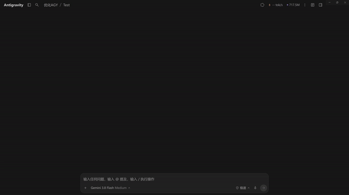
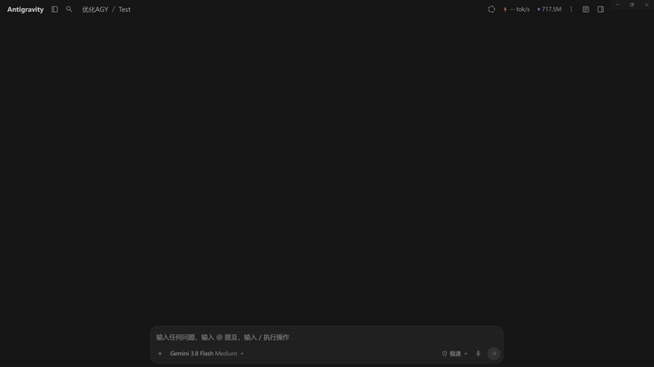
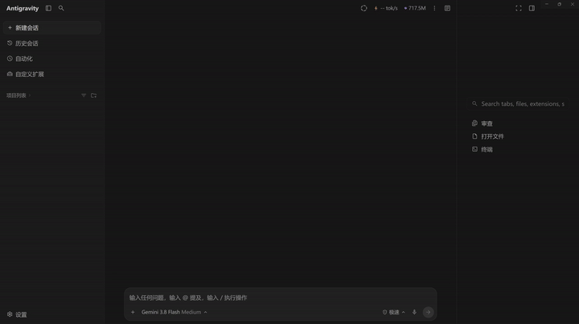
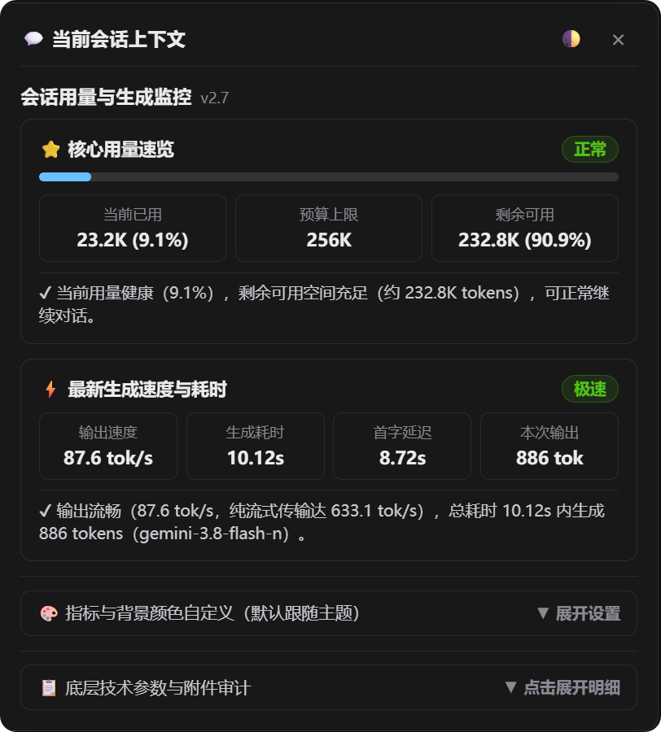
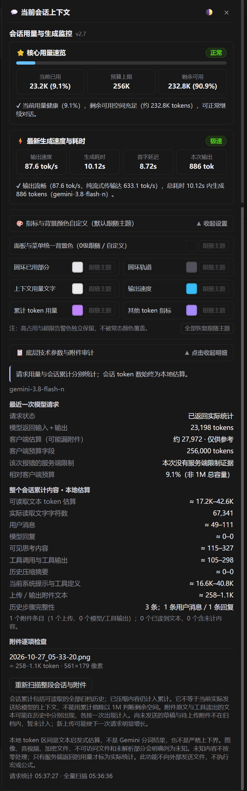
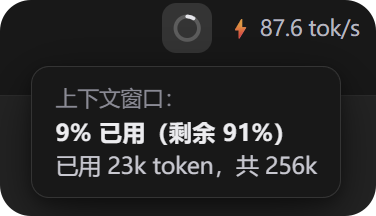
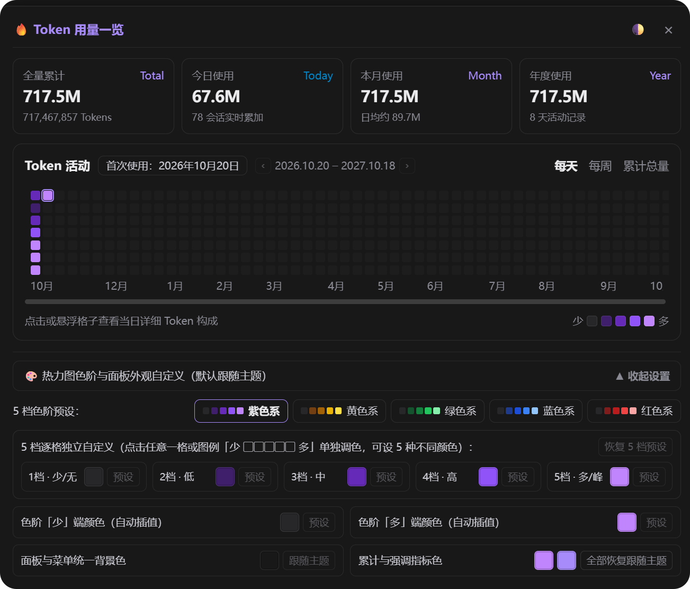

# Antigravity 对话上下文查看器 & Token 用量看板 (Antigravity Context & Token Viewer)

<p align="center">
  
  
  
  
  
  <a href="https://linux.do/"></a>
</p>

<p align="center">
  <b>简体中文</b> | <a href="README.en.md">English</a> | <a href="README.ja.md">日本語</a> | <a href="README.ko.md">한국어</a> | <a href="README.es.md">Español</a>
</p>

专为 **Google Antigravity 桌面客户端 (2.x)** 打造的原厂级 **「单次会话上下文与生成监控 + 账号全局 Token 计数热力图 + 模型实时输出速度监控」** 全功能可视化套件。采用与 `antigravity-chinese` 相同的 **ASAR 持久化注入 + CDP 免重启热挂载** 架构，**零第三方 npm 依赖**，既支持双击脚本一键安装，也支持直接丢给任何 AI 智能体（Antigravity / Codex / Claude Code / Cursor）一句话自动部署。

> [!NOTE]
> **关于深色与浅色模式画面适配**：  
> 因为作者是懒狗，所以浅色画面没有截图和演示图片，但是一样是做了适配的（支持跟随系统或 Antigravity 主题自由切换浅色/深色，顶栏胶囊、原生气泡与双独立面板均已完成无缝自适应）。

---

## 🎬 界面与交互演示动画 (Video & Animation Previews)

本次 v2.7.2 版本提供 4 组涵盖全部交互层面的演示动画与高清录像：

### 1. 当前会话上下文监控与底层技术参数附件审计
> 演示文件：`01-当前会话上下文监控与底层技术参数附件审计.mp4`

点击顶栏环形胶囊呼出「当前会话上下文」面板，查看核心用量速览、最新生成速度耗时，展开并滚览底层技术参数、真实服务端口径校准、图片像素尺寸格式化（如 `561×179 像素`）与全格式附件审计明细：

<p align="center">
  <a href="assets/demo-01-context-audit.mp4">
    
  </a>
  <br>
  <sub>🎬 演示动画：会话上下文面板、速度监控与底层审计明细 (<a href="assets/demo-01-context-audit.mp4">高清视频：01-当前会话上下文监控与底层技术参数附件审计.mp4</a>)</sub>
</p>

---

### 2. Token 历史用量统计与 52 周活跃热力图交互
> 演示文件：`02-Token历史用量统计与52周活跃热力图交互.mp4`

点击顶栏 Token 累计胶囊弹出「Token 用量一览」面板，展示全量累计/今日/本月/年度 4 大维度用量卡片、52 周日历热力图，并在热力图方格之间移动悬停，即时呈现包含 Prompt/Output/Cache 或未来日期状态的原生 Tooltip 气泡：

<p align="center">
  <a href="assets/demo-02-token-heatmap.mp4">
    
  </a>
  <br>
  <sub>🎬 演示动画：Token 四维指标卡片与 52 周热力图悬浮气泡交互 (<a href="assets/demo-02-token-heatmap.mp4">高清视频：02-Token历史用量统计与52周活跃热力图交互.mp4</a>)</sub>
</p>

---

### 3. 独立双面板平滑切换与侧边栏防遮挡自适应
> 演示文件：`03-独立双面板平滑切换与侧边栏防遮挡自适应.mp4`

在开启右侧辅助栏（审查/文件/终端）的复杂布局下，面板智能计算右侧边界并贴边自适应停靠，杜绝内容裁切；通过点击顶栏不同胶囊即可在「Token 用量一览」与「当前会话上下文」之间顺滑切换：

<p align="center">
  <a href="assets/demo-03-panel-switching.mp4">
    
  </a>
  <br>
  <sub>🎬 演示动画：侧边栏防裁切停靠与独立双面板无缝平滑互切 (<a href="assets/demo-03-panel-switching.mp4">高清视频：03-独立双面板平滑切换与侧边栏防遮挡自适应.mp4</a>)</sub>
</p>

---

### 4. 顶栏胶囊多级响应式折叠与窄屏自适应
> 演示文件：`04-顶栏胶囊多级响应式折叠与窄屏自适应.mp4`

当同时开启左侧项目侧边栏与右侧辅助栏导致主工作区宽度极窄时，顶栏右上角胶囊群触发 4 级阶梯平滑响应式折叠（从完整文本 -> 纯数字 -> 紧凑环形图标与更多菜单），始终不溢出、不破坏顶栏原生布局，且折叠状态下点击环形仍可完美唤起面板：

<p align="center">
  <a href="assets/demo-04-responsive-collapse.mp4">
    
  </a>
  <br>
  <sub>🎬 演示动画：顶栏胶囊 4 级响应式阶梯折叠与紧凑态呼出 (<a href="assets/demo-04-responsive-collapse.mp4">高清视频：04-顶栏胶囊多级响应式折叠与窄屏自适应.mp4</a>)</sub>
</p>

---

## 📸 面板实拍与功能细节 (Screenshots & UI Details)

| 01. 会话上下文与生成监控主视图 | 02. 会话上下文全展开：外观调色与底层审计 |
| :---: | :---: |
|  |  |
| 置顶 **「⭐ 核心用量速览」**（当前已用、预算上限、剩余可用）与 **「⚡ 最新生成速度与耗时速览」**（输出速度 87.6 tok/s、生成耗时 10.12s、首字延迟 8.72s、本次输出 886 tok）；下方提供收起的调色抽屉与参数审计入口。 | 展开 **「🎨 指标与背景颜色自定义」**（支持面板统一 0 级背景跟随与指标色自定义）及 **「📋 底层技术参数与附件审计」**（服务端真实返回、本地全会话字符估算、图片像素尺寸与 token 审计、重新扫描入口）。 |

| 03. 顶栏环形胶囊、实时速度与原生气泡提示 | 04. Token 用量总览与 5 档热力图逐格独立自定义 |
| :---: | :---: |
|  |  |
| 顶栏常驻圆环用量进度胶囊与 ⚡ 速度胶囊（如 `87.6 tok/s`）；鼠标悬浮弹出原生层级三层气泡 Tooltip，直观展示已用百分比、剩余百分比与精确 token 数量。 | 顶部四栏指标卡片展示 **全量累计 (Total)、今日使用 (Today)、本月使用 (Month)、年度使用 (Year)**；52 周热力图网格支持 **每天 / 每周 / 累计总量** 三视图；下方展开 **5 套色阶预设**、**5 档逐格独立调色** 与 **两端插值生成器**。 |

---

## ✨ 核心功能全景 (Comprehensive Features)

### 1. 顶栏环形进度指示器与极速模型性能监控
- **原生暗色融合双胶囊**：常驻顶栏右上角，未激活时隐形融入标题栏，交互时通过弹性曲线展开；
- **环形圆环上下文指示器 (`#badge-context`)**：以精致的环形进度圈展示当前单次会话窗口占用比例，鼠标悬浮显示原生 3 层气泡 Tooltip；
- **实时输出速度胶囊 (`#badge-speed`)**：精确捕获模型最新生成的首字延迟 (TTFT)、纯流式解码速度 (tok/s)、总生成耗时与输出规模；
- **4 级阶梯响应式折叠**：当侧边栏挤压主窗口或分辨率受限时，自动平滑阶梯折叠，防止覆盖顶栏原有功能。

### 2. 解耦独立双面板与防遮挡自适应停靠
- **彻底解耦的双面板架构**：会话上下文面板与 Token 统计面板相互独立，通过点击顶栏胶囊直接呼出对应面板，并可在两面板间直接无缝切换；
- **侧边栏防裁切自适应定位**：动态读取主视口与右侧辅助面板边界，在开启辅助栏时自动左移停靠，确保弹窗内容完整可见。

### 3. 会话上下文监控面板 (Panel A)
- **⭐ 核心用量速览**：首屏三栏直接呈现**当前已用 / 预算上限 / 剩余可用**核心数值与健康状态胶囊；
- **⚡ 最新生成速度与耗时速览**：4 栏网格展示输出速度、生成耗时、首字响应延迟 (TTFT) 与本次产出 Token，附带极速/流畅评级；
- **🎨 指标与背景颜色自定义抽屉**：
  - 支持面板统一背景色（跟随主题或自定义 0 级深色）；
  - 支持圆环进度、文字、速度、累计 Token 等多槽位指标独立调色；
  - 提供一键恢复默认。
- **📋 底层技术参数与全格式附件审计**：
  - **真实服务端校准**：严格区分模型返回的真实输入+输出 Token 与本地全会话估算，服务端超限时直接高亮预警；
  - **全会话本地估算拆解**：逐项统计用户消息、模型回复、思考过程、工具调用与系统提示字符与 Token 区间；
  - **附件逐项审计**：准确识别并展示图片附件的实际像素尺寸（如 `561×179 像素`）并计算 Token，兼容 Office 文档、PDF 与代码附件；
  - **重新扫描**：支持随时一键重新扫描整段会话与附件。

### 4. 账号全局 Token 计数与 52 周活跃热力图 (Panel B)
- **四大维度用量卡片**：全量累计 (Total)、今日使用 (Today)、本月使用 (Month)、年度使用 (Year)，全面采用国际通用缩写 (M / B)；
- **GitHub / ChatGPT 风格 52 周热力图**：呈现 365 天历史 Token 消耗分布；
- **三视图无缝切换**：支持「每天（7×52 日历网格）」、「每周（周度趋势）」与「累计总量（增长面积图）」；
- **每日明细 Tooltip 气泡**：悬停格子即时展示当日 Prompt / Output / Cache 明细及中文标签；
- **🎨 5 档色阶加法自定义系统**：
  - **5 套整套预设**：紫色系、黄色系、绿色系、蓝色系、红色系一键应用；
  - **5 档逐格独立自定义**：右下角「少 ▢▢▢▢▢ 多」图例的 5 个格子均可直接点击弹出调色盘；同时在抽屉内提供 1 档~5 档独立色块微调与单档重置；
  - **两端线性插值**：支持仅设置「少端色」与「多端色」，自动平滑插值生成中间梯度；
  - **层级优先级**：单格独立自定义 > 两端插值 > 整套预设，灵活自由。

---

## 🌐 界面语种与多语言翻译说明 (UI Localization & Multi-Language)

本项目默认界面文案为 **简体中文**。如果你需要插件界面（顶栏胶囊文案、详情面板与热力图提示）显示为你自己的母语（例如 **English / 日本語 / 한국어 / Español** 或任意其他语言）：

> [!TIP]
> **无需安装额外多语言包，也无需手动修改配置文件！**  
> 只需要把本仓库交给你的 AI 智能体（Antigravity / Claude Code / Codex / Cursor）安装时，对它说一句：  
> **“读取 AGENTS.md 帮我安装，并把界面文案翻译成 [你的目标语言，如 English / 日本語 / 한국어 / Español]”**  
> 
> AI 就会自动解析 `meter-renderer.js` 中的 UI 文本，将其无损替换为对应语言并执行安装热注入，免重启即刻呈现本地化界面。

---

## 🤖 给 AI 智能体的一键安装指令 (For AI Agents)

如果你将本仓库交给 AI 助手安装，只需对 AI 说：**“读取仓库里的 `AGENTS.md` 或 `README.md`，帮我安装这个上下文查看器与 Token 看板”**。

AI 智能体只需在仓库根目录执行以下单条命令即可完成**持久化安装 + 当前运行窗口免重启热生效**：

```bash
# 1. 一键持久化安装并热注入当前运行中的 Antigravity 窗口（无需强杀进程、无需 npm install）
node cli.js install

# 2. 验证安装与运行状态
node cli.js status
```

> [!IMPORTANT] **AI 智能体执行规范（见 [`AGENTS.md`](AGENTS.md)）**：
> - **零外部依赖**：内置原生 Node.js ASAR 解包/封包引擎（[`asar-engine.js`](asar-engine.js)），无需执行 `npm install`。
> - **与汉化补丁 100% 兼容**：基于当前 `app.asar` 原位无损注入，完整保留已安装的 `antigravity-chinese` 汉化词库与补丁。
> - **严禁强杀宿主进程**：在 Antigravity 会话内执行时，切勿关闭或杀死 `Antigravity.exe`；`node cli.js install` 会自动通过 `DevToolsActivePort` 将最新 UI 热挂载到当前窗口，1 秒内即时生效。

---

## 🚀 快速开始 (Quick Start)

### 方式一：一键脚本（适合日常手动安装）

- **Windows**：
  - 安装 / 更新：双击运行 [`install.bat`](install.bat)
  - 卸载 / 还原：双击运行 [`uninstall.bat`](uninstall.bat)
- **macOS / Linux**：
  - 安装 / 更新：`./install.sh`
  - 卸载 / 还原：`./uninstall.sh`

### 方式二：CLI 命令行管理器

```bash
# 1. 环境健康预检（自动探测 Node、Antigravity 安装路径、CDP 端口与 Python）
node cli.js check

# 2. 一键安装（ASAR 持久化注入 + 当前运行窗口 CDP 即时热生效）
node cli.js install

# 3. 仅对当前运行窗口进行 CDP 免改盘热挂载
node cli.js live

# 4. 查看当前安装状态与实时会话上下文用量
node cli.js status

# 5. 一键无损还原安装前的原始 app.asar
node cli.js restore

# 6. 指定自定义客户端路径安装
node cli.js install --path "D:\YourPath\Antigravity\resources\app.asar"
```

---

## 🧪 自动化测试 (Testing)

```bash
npm test
# 或直接运行：
node --test meter-core.test.js meter-renderer.test.js
```

包含 38 项针对 Token 缓存去重、服务端超限覆盖、异步会话切换防串染、5 档色阶独立自定义、图例调色弹窗、图片尺寸格式化与双面板定位的完整回归测试。

---

## 📁 仓库结构 (Repository Structure)

```text
antigravity-context-viewer/
├── assets/                                 # 演示动图、高清录屏与实拍截图
│   ├── demo-01-context-audit.gif / .mp4    # 演示 1：会话上下文监控与底层技术参数附件审计
│   ├── demo-02-token-heatmap.gif / .mp4    # 演示 2：Token 历史用量统计与 52 周活跃热力图交互
│   ├── demo-03-panel-switching.gif / .mp4  # 演示 3：独立双面板平滑切换与侧边栏防遮挡自适应
│   ├── demo-04-responsive-collapse.gif/.mp4# 演示 4：顶栏胶囊多级响应式折叠与窄屏自适应
│   ├── panel-context-main.png              # 实拍 1：会话上下文与生成监控主视图
│   ├── panel-context-audit-expanded.png    # 实拍 2：会话上下文全展开：外观调色与底层审计
│   ├── capsule-speed-and-tooltip.png       # 实拍 3：顶栏环形胶囊、实时速度与原生气泡提示
│   └── panel-token-heatmap-customizer.png  # 实拍 4：Token 用量总览与 5 档热力图逐格独立自定义
├── asar-engine.js                          # 零外部依赖的纯原生 Node.js ASAR 打包/解包引擎
├── cli.js                                  # 统一命令行接口 (install / live / status / check / restore)
├── install.js                              # ASAR 注入与运行时热挂载调度器
├── restore.js                              # 原始备份校验与无损还原调度器
├── meter-main.js                           # Electron 主进程窗口钩子与只读 IPC 通道
├── meter-core.js                           # 上下文估算、Token 统计与分词引擎
├── meter-renderer.js                       # 顶栏环形双胶囊、解耦双面板、5档热力图自定义渲染器
├── meter-collector.js                      # 本地会话归档读取与附件提取收集器
├── attachment_scan.py                      # 全格式附件只读分析核心脚本 (Office / PDF / Code)
├── AGENTS.md                               # AI 智能体专用一键安装与校验指南
├── install.bat / install.sh                # 一键安装入口脚本
└── uninstall.bat / .sh                     # 一键卸载与还原入口脚本
```

---

## 🤝 社区与支持 (Community & Acknowledgements)

- **[LINUX DO](https://linux.do/)**：本项目支持并认可 LINUX DO 社区，欢迎各位社区佬友交流探讨。
